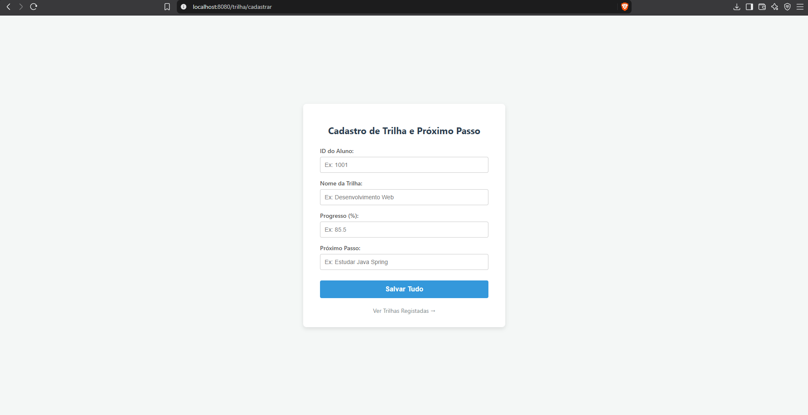
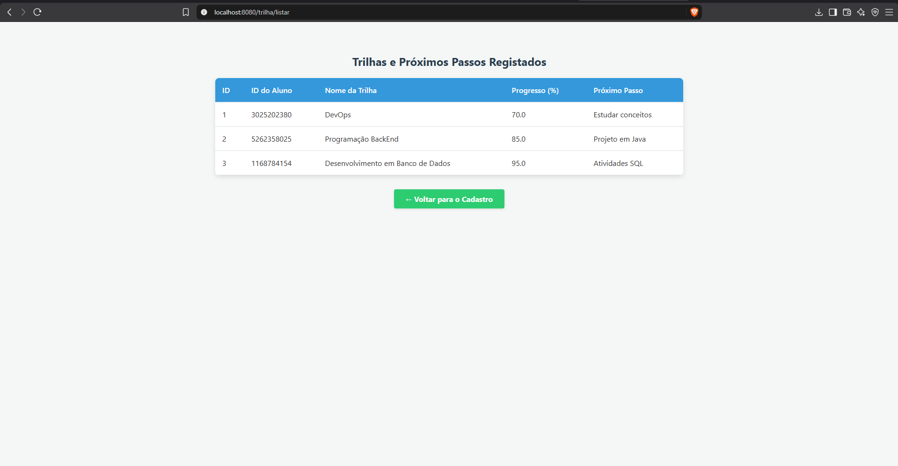

# TrilhaIA

Aplicação web em Java que registra o **progresso de alunos em trilhas de aprendizagem** e o **próximo passo de estudo** de cada um. É o módulo de acompanhamento do projeto [Próximo Passo](https://github.com/vitoramaro2700-cyber/proximo-passo), desenvolvido por iniciativa própria.

Projeto acadêmico do curso de Análise e Desenvolvimento de Sistemas.

## Funcionalidades

- Cadastro de trilha com ID do aluno, nome da trilha, progresso (%) e próximo passo
- Listagem das trilhas registradas em tabela
- Persistência local em SQLite, criada automaticamente na primeira execução

## Telas





## Tecnologias

- Java 17
- Spring Boot 3.5 (Web, Data JPA, Thymeleaf)
- SQLite com Hibernate Community Dialects
- Maven (wrapper incluso)

## Como executar

Requisitos: **Java 17** ou superior. O Maven não precisa estar instalado.

```bash
git clone https://github.com/vitoramaro2700-cyber/trilha-ia.git
cd trilha-ia
./mvnw spring-boot:run
```

No Windows, use `mvnw.cmd spring-boot:run`.

Depois, acesse: <http://localhost:8080/trilha/cadastrar>

O arquivo `trilhaia.db` é criado na pasta do projeto ao iniciar.

## Rotas

| Método | Rota | Descrição |
|--------|------|-----------|
| GET | `/trilha/cadastrar` | Formulário de cadastro |
| POST | `/trilha/salvar` | Salva a trilha e redireciona para a listagem |
| GET | `/trilha/listar` | Lista as trilhas registradas |

## Estrutura

```
src/main/java/com/ava/TrilhaIA/
├── TrilhaIA.java
├── controller/TrilhaController.java
├── model/TrilhaModel.java
└── repository/TrilhaRepository.java
src/main/resources/
├── application.properties
└── templates/
    ├── trilha_forms.html
    └── trilha_listar.html
```

## Modelo de dados

| Campo | Tipo | Descrição |
|-------|------|-----------|
| `id` | Long | Identificador gerado automaticamente |
| `aluno_id` | Long | ID do aluno |
| `nome_trilha` | String | Nome da trilha de aprendizagem |
| `progresso_pct` | Double | Percentual de progresso |
| `proximo_passo` | String | Próximo passo de estudo |

## Próximos passos

- [ ] Editar e excluir trilhas
- [ ] Filtrar por aluno
- [ ] Validação dos campos do formulário
- [ ] Integração com o projeto Próximo Passo

## Autor

**Vitor Amaro**
[LinkedIn](https://www.linkedin.com/in/vitor-amaroo)
